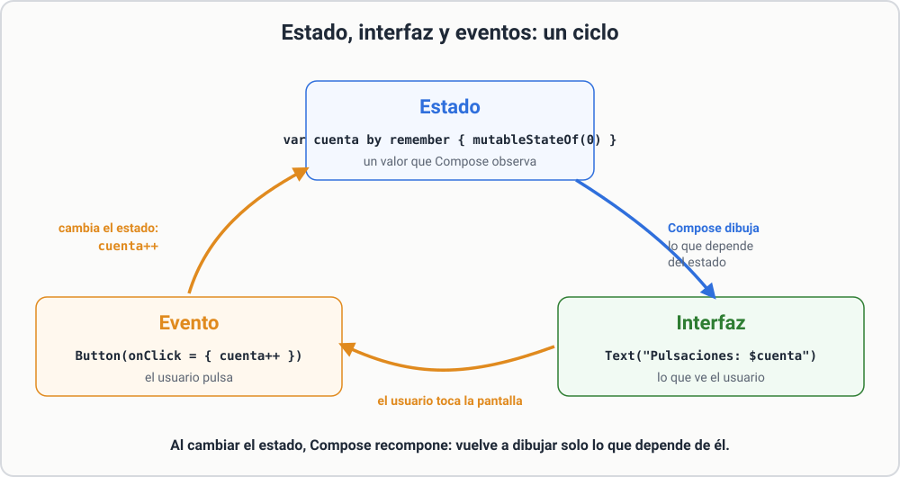
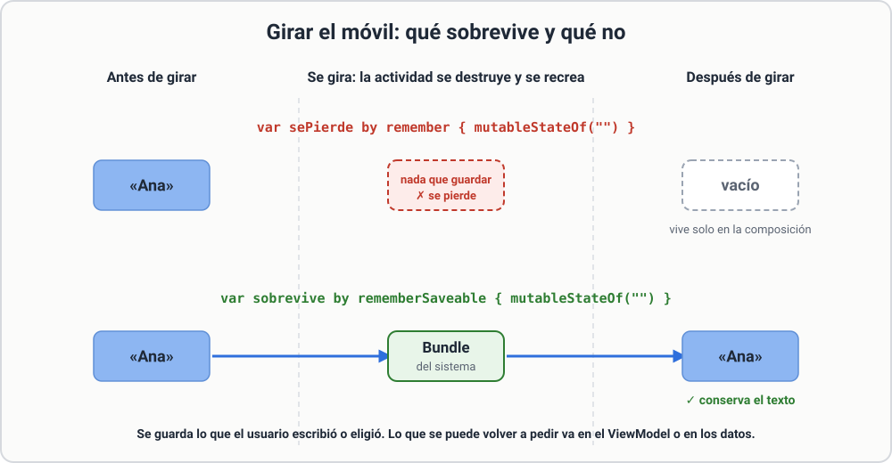

# 2.3 Estado: la pantalla que cambia

Si pulsas un botón y quieres que cambie un texto, necesitas **estado**: un valor que, al cambiar, hace que Compose **vuelva a dibujar** lo que depende de él (se llama *recomposición*).

```kotlin
@Composable
fun Contador() {
    var cuenta by remember { mutableStateOf(0) }

    Column {
        Text("Pulsaciones: $cuenta")
        Button(onClick = { cuenta++ }) {
            Text("Sumar")
        }
    }
}
```

* `mutableStateOf(0)` crea un valor observable.
* `remember { }` lo **recuerda** entre recomposiciones; sin `remember`, la variable volvería a 0 cada vez que se redibuja.
* `by` permite usar `cuenta` directamente en lugar de `cuenta.value`.

[](../assets/img/estado-recomposicion.svg){ target=_blank title="Abrir a tamaño completo" }

*Figura. El ciclo de Compose: un evento cambia el estado y Compose recompone solo lo que depende de él.*

## ¿Y si giro la pantalla?

Al girar el móvil la *activity* se destruye y se crea de nuevo, y `remember` pierde su valor. Para sobrevivir al giro se usa `rememberSaveable`:

```kotlin
var cuenta by rememberSaveable { mutableStateOf(0) }
```

| Función | Sobrevive a recomposición | Sobrevive al giro |
|---|---|---|
| `remember` | Sí | No |
| `rememberSaveable` | Sí | Sí |

[](../assets/img/remember-rotacion.svg){ target=_blank title="Abrir a tamaño completo" }

*Figura. Al girar el móvil la actividad se destruye y se recrea: `remember` se pierde y `rememberSaveable` sobrevive en el `Bundle`.*

## Reglas de oro

1. La interfaz es **una función del estado**: cambia el estado y la pantalla se actualiza sola. No se modifica la vista a mano.
2. Un composable no debe tener efectos secundarios en su cuerpo (no hagas peticiones de red ahí).
3. Guarda en el estado solo lo mínimo; lo que se puede calcular, se calcula.

!!! example "Ejemplo: alternar un texto"
    ```kotlin
    var visible by remember { mutableStateOf(true) }
    Button(onClick = { visible = !visible }) { Text(if (visible) "Ocultar" else "Mostrar") }
    if (visible) Text("¡Hola!")
    ```
