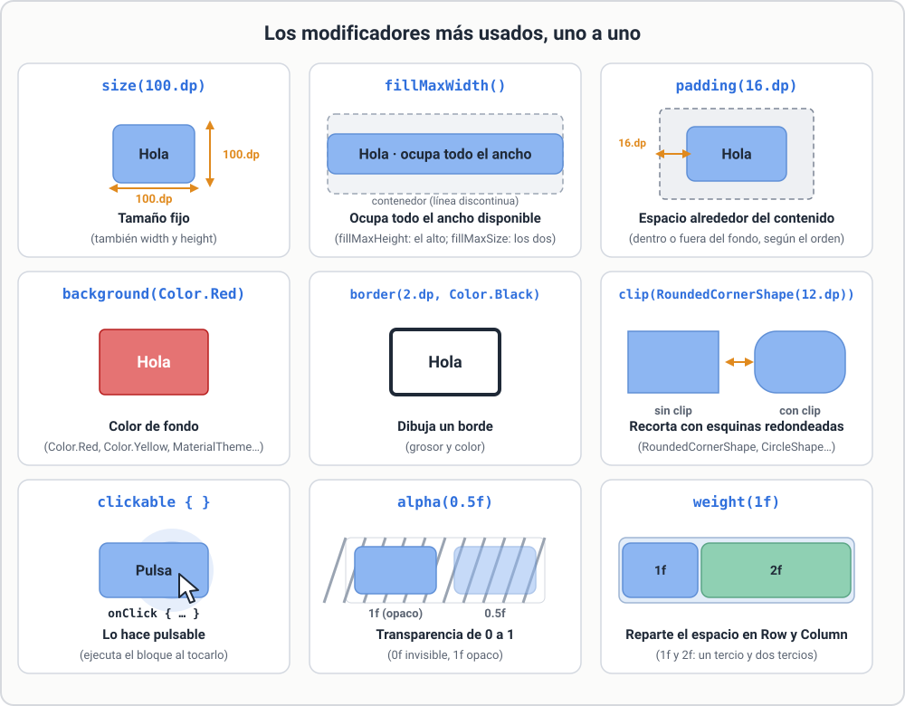
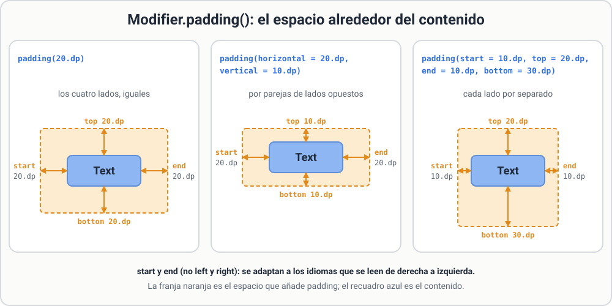
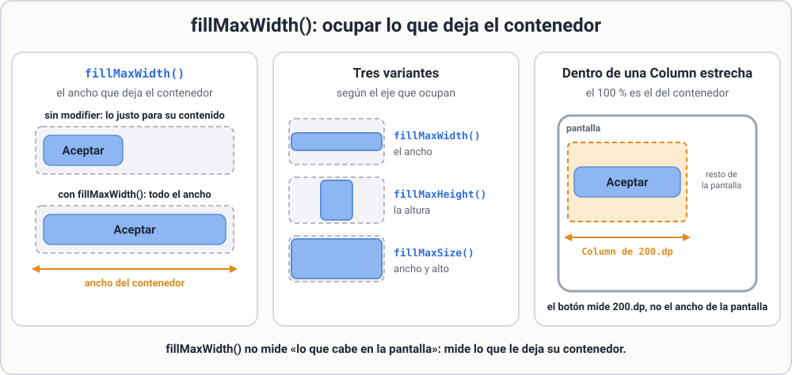
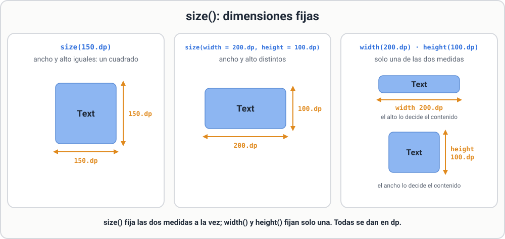
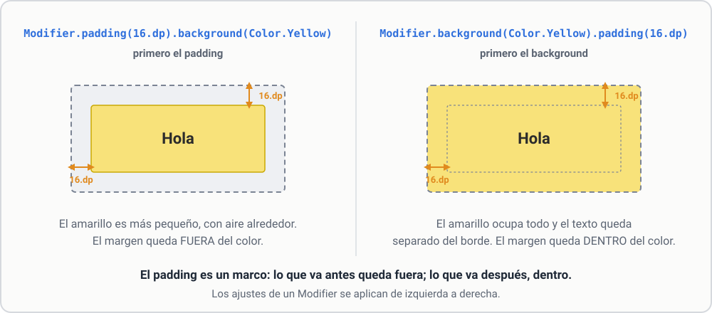
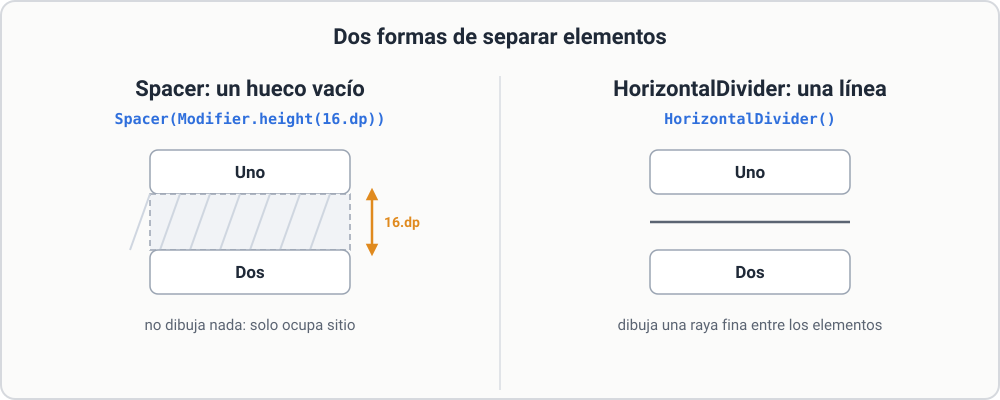

# 3.2 Modifier

Todo composable visible acepta un parámetro `modifier`. Un `Modifier` es una **cadena de ajustes** que se aplican de izquierda a derecha:

```kotlin
Text(
    "Hola",
    modifier = Modifier
        .padding(16.dp)
        .background(Color.Yellow)
        .fillMaxWidth()
)
```

## Los modificadores más usados

| Modifier | Qué hace |
|---|---|
| `padding(16.dp)` | Espacio **alrededor** (por dentro del fondo si va después del `background`) |
| `size(100.dp)`, `width`, `height` | Tamaño fijo |
| `fillMaxWidth()`, `fillMaxHeight()`, `fillMaxSize()` | Ocupar todo el espacio disponible |
| `background(Color.Red)` | Color de fondo |
| `border(2.dp, Color.Black)` | Borde |
| `clip(RoundedCornerShape(12.dp))` | Recortar con esquinas redondeadas |
| `clickable { }` | Hacerlo pulsable |
| `weight(1f)` | Repartir espacio en Row/Column |
| `alpha(0.5f)` | Transparencia |

[](../assets/img/modifier-metodos.svg){ target=_blank title="Abrir a tamaño completo" }

*Figura. Cada modificador de la tabla, con su efecto.*

## `padding`: el espacio de cada lado

Con un solo valor, el espacio es igual en los cuatro lados. También puedes darlo por parejas o lado por lado. Se usan `start` y `end` (no izquierda y derecha) para que la pantalla se adapte a los idiomas que se leen de derecha a izquierda:

```kotlin
Modifier.padding(20.dp)                                    // los cuatro lados
Modifier.padding(horizontal = 20.dp, vertical = 10.dp)     // por parejas
Modifier.padding(start = 10.dp, top = 20.dp, end = 10.dp, bottom = 30.dp)   // uno a uno
```

[](../assets/img/padding-lados.svg){ target=_blank title="Abrir a tamaño completo" }

*Figura. Las tres formas de `padding`: la franja naranja es el espacio que se añade y el recuadro azul, el contenido, que no cambia de tamaño.*

## `fillMaxWidth`: ocupar todo el ancho

`Modifier.fillMaxWidth()` hace que el elemento ocupe **todo el ancho que le deja su contenedor**. Existen también `fillMaxHeight()` (la altura) y `fillMaxSize()` (ancho y alto a la vez).

```kotlin
Button(
    onClick = { },
    modifier = Modifier.fillMaxWidth()
) { Text("Aceptar") }
```

!!! note "El ancho es el del contenedor, no el de la pantalla"
    Dentro de una `Column` que mide 200.dp de ancho, un botón con `fillMaxWidth()` mide 200.dp.

[](../assets/img/fillmax.svg){ target=_blank title="Abrir a tamaño completo" }

*Figura. Con y sin `fillMaxWidth()`, las tres variantes y qué pasa dentro de un contenedor estrecho.*

## `size`: dimensiones fijas

`Modifier.size()` fija el ancho y el alto **a la vez**. Con `width()` y `height()` se fija solo una de las dos medidas:

```kotlin
Modifier.size(150.dp)                            // cuadrado de 150.dp
Modifier.size(width = 200.dp, height = 100.dp)   // rectángulo
Modifier.width(200.dp)                           // solo el ancho
Modifier.height(100.dp)                          // solo el alto
```

[](../assets/img/size-dimensiones.svg){ target=_blank title="Abrir a tamaño completo" }

*Figura. `size` fija las dos medidas; `width` y `height`, solo una (la otra la decide el contenido).*

## El orden importa

```kotlin
// Margen fuera del color
Modifier.padding(16.dp).background(Color.Yellow)

// Margen dentro del color
Modifier.background(Color.Yellow).padding(16.dp)
```

En el primero el amarillo es más pequeño, con aire alrededor. En el segundo el amarillo ocupa todo y el texto queda separado del borde. Piensa en el `padding` como un **marco**: lo que va antes queda fuera, lo que va después queda dentro.

[](../assets/img/modifier-orden.svg){ target=_blank title="Abrir a tamaño completo" }

*Figura. Los mismos dos modificadores en distinto orden dan resultados distintos.*

## Espacios y separadores

```kotlin
Column {
    Text("Uno")
    Spacer(Modifier.height(16.dp))
    Text("Dos")
}
```

`Spacer` es un hueco vacío. Para líneas de separación existe `HorizontalDivider()`.

[](../assets/img/espacios.svg){ target=_blank title="Abrir a tamaño completo" }

*Figura. `Spacer` separa con un hueco; `HorizontalDivider` separa con una línea.*

## Reutilizar un modifier

El composable que escribas debería aceptar siempre un `modifier` como primer parámetro opcional:

```kotlin
@Composable
fun Etiqueta(texto: String, modifier: Modifier = Modifier) {
    Text(texto, modifier = modifier.padding(8.dp))
}
```

Así quien lo use puede colocarlo y dimensionarlo sin tocar tu código.
