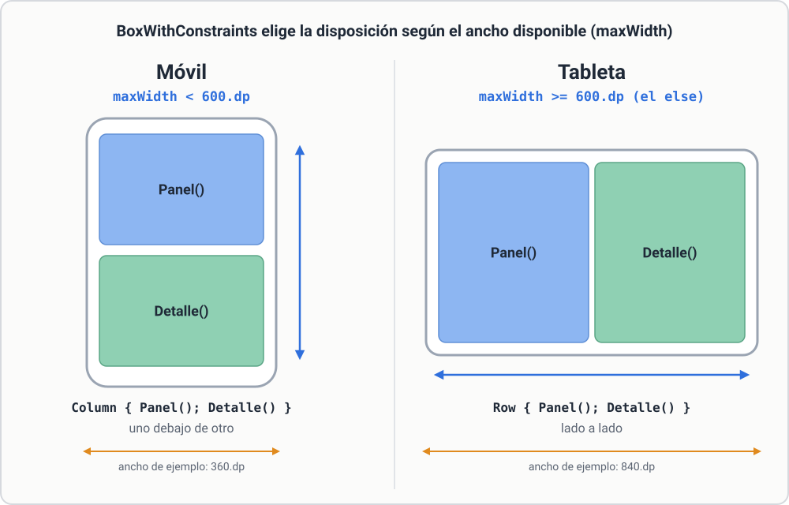
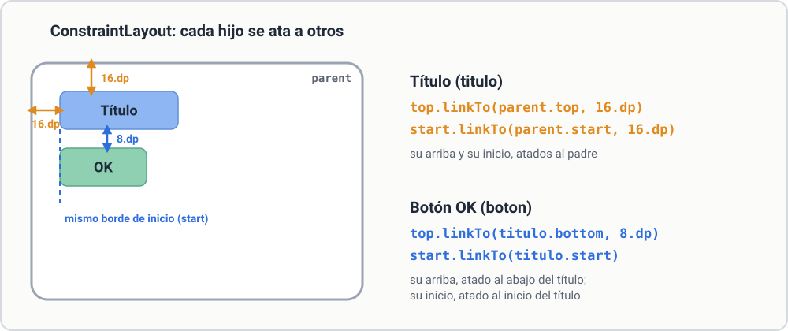
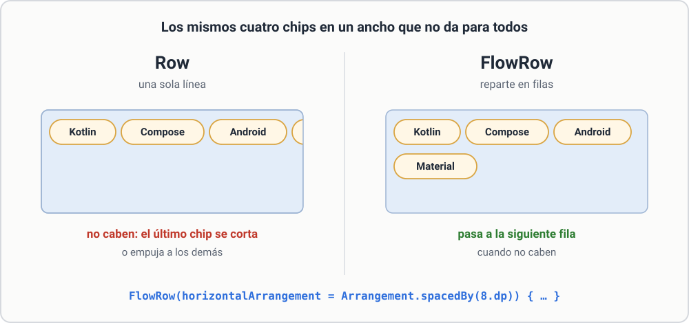
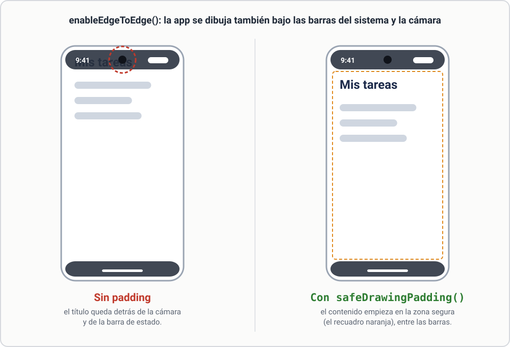

# 3.4 Para ir más allá

## Layouts que se adaptan al tamaño

`BoxWithConstraints` te dice cuánto espacio tiene y permite elegir distinta disposición:

```kotlin
BoxWithConstraints {
    if (maxWidth < 600.dp) {
        Column { Panel(); Detalle() }      // móvil: uno debajo de otro
    } else {
        Row { Panel(); Detalle() }         // tableta: lado a lado
    }
}
```

[](../assets/img/adaptable.svg){ target=_blank title="Abrir a tamaño completo" }

*Figura. La misma pantalla con dos disposiciones, según el ancho disponible (`maxWidth`).*

## ConstraintLayout

Para pantallas complejas con muchas relaciones («este botón a la derecha de aquel»), existe `ConstraintLayout` (librería `androidx.constraintlayout:constraintlayout-compose`):

```kotlin
ConstraintLayout(Modifier.fillMaxSize()) {
    val (titulo, boton) = createRefs()
    Text("Título", Modifier.constrainAs(titulo) { top.linkTo(parent.top, 16.dp); start.linkTo(parent.start, 16.dp) })
    Button(onClick = { }, Modifier.constrainAs(boton) { top.linkTo(titulo.bottom, 8.dp); start.linkTo(titulo.start) }) { Text("OK") }
}
```

[](../assets/img/constraintlayout.svg){ target=_blank title="Abrir a tamaño completo" }

*Figura. Las cuatro restricciones del ejemplo: cada `linkTo` ata un borde de un hijo a un borde de otro elemento.*

Úsalo solo cuando `Column`, `Row` y `Box` anidados se vuelven ilegibles.

## FlowRow: que salte de línea

```kotlin
FlowRow(horizontalArrangement = Arrangement.spacedBy(8.dp)) {
    listOf("Kotlin", "Compose", "Android", "Material").forEach { AssistChip(onClick = { }, label = { Text(it) }) }
}
```

Reparte los hijos en filas y pasa a la siguiente cuando no caben (ideal para etiquetas).

[](../assets/img/flowrow.svg){ target=_blank title="Abrir a tamaño completo" }

*Figura. Los mismos cuatro chips en un ancho que no da para todos: en una `Row` no caben; en un `FlowRow` pasan a la fila de abajo.*

## Insets y barras del sistema

En Android moderno la app se dibuja bajo la barra de estado y la de navegación (y bajo la cámara). `enableEdgeToEdge()` en `onCreate` lo activa y `Modifier.safeDrawingPadding()` o `Modifier.safeContentPadding()` evitan que el contenido quede tapado. Si un título aparece oculto por la cámara, es lo primero que debes revisar.

[](../assets/img/insets.svg){ target=_blank title="Abrir a tamaño completo" }

*Figura. Con `enableEdgeToEdge()` la app se dibuja bajo las barras del sistema; `safeDrawingPadding()` deja el contenido en la zona segura.*

## Aviso: APIs experimentales

Algunos componentes (`FlowRow`, `TopAppBar`, `DatePicker`, `AssistChip`…) están marcados como experimentales. Si el compilador lo pide, añade sobre la función `@OptIn(ExperimentalMaterial3Api::class)` (o `ExperimentalLayoutApi`).
