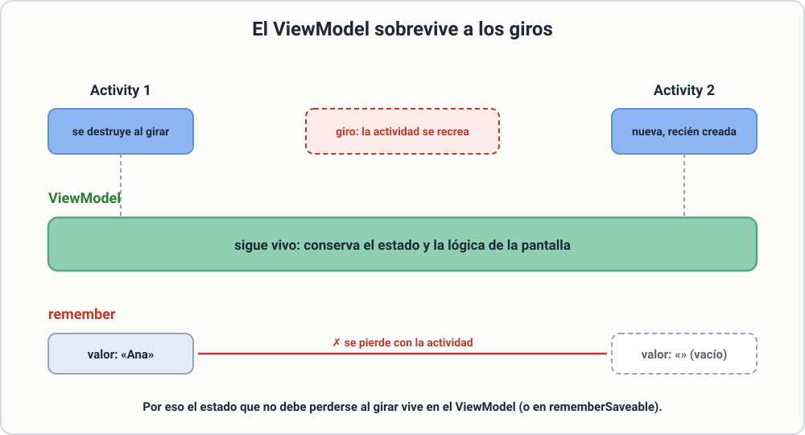
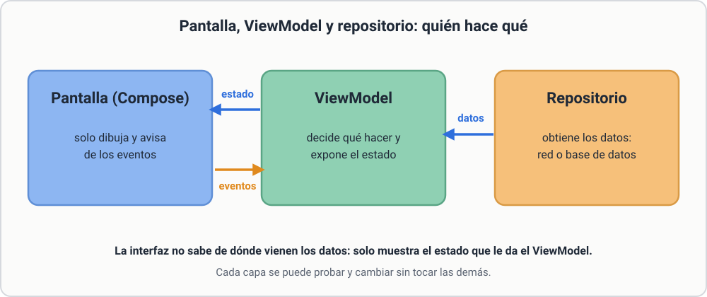

# 8.2 ViewModel y arquitectura

Hasta ahora el estado vivía dentro de los composables. En apps grandes eso se vuelve inmanejable: la lógica se mezcla con el dibujo y, aun con `rememberSaveable`, no se comparte entre pantallas.

El **ViewModel** es una clase que **guarda el estado y la lógica** de una pantalla y **sobrevive a los giros** y cambios de configuración.

[](../assets/img/viewmodel-giro.svg){ target=_blank title="Abrir a tamaño completo" }

*Figura. Al girar, la actividad se recrea; el `ViewModel` sigue vivo y `remember` empieza de cero.*

## Esquema

```
Pantalla (Compose)  ←─ estado ─  ViewModel  ←── datos ──  Repositorio / red / BD
      │                              ▲
      └────── eventos (clics) ───────┘
```

* La **UI** solo dibuja y avisa de eventos.
* El **ViewModel** decide qué hacer y expone el estado.
* El **repositorio** obtiene los datos (red o base de datos).

[](../assets/img/mvvm-capas.svg){ target=_blank title="Abrir a tamaño completo" }

*Figura. Quién hace qué: la pantalla dibuja, el `ViewModel` decide y el repositorio trae los datos.*

## Un ViewModel con estado

```kotlin
data class TareasUi(val tareas: List<String> = emptyList(), val cargando: Boolean = false)

class TareasViewModel : ViewModel() {
    private val _ui = MutableStateFlow(TareasUi())
    val ui: StateFlow<TareasUi> = _ui.asStateFlow()

    fun anadir(texto: String) {
        if (texto.isBlank()) return
        _ui.update { it.copy(tareas = it.tareas + texto) }
    }

    fun borrar(texto: String) {
        _ui.update { it.copy(tareas = it.tareas - texto) }
    }
}
```

* `MutableStateFlow` es privado: **solo el ViewModel** puede cambiar el estado.
* `StateFlow` es lo que se expone, de solo lectura.
* Siempre se crea un **nuevo** objeto (`copy`) en lugar de modificar el anterior.

## Usarlo en la pantalla

Dependencia: `androidx.lifecycle:lifecycle-viewmodel-compose` y `androidx.lifecycle:lifecycle-runtime-compose`.

```kotlin
@Composable
fun TareasPantalla(vm: TareasViewModel = viewModel()) {
    val ui by vm.ui.collectAsStateWithLifecycle()
    var nueva by remember { mutableStateOf("") }

    Column(Modifier.padding(16.dp)) {
        Row {
            OutlinedTextField(nueva, { nueva = it }, Modifier.weight(1f))
            Button(onClick = { vm.anadir(nueva); nueva = "" }) { Text("Añadir") }
        }
        LazyColumn {
            items(ui.tareas) { t ->
                Row {
                    Text(t, Modifier.weight(1f))
                    IconButton(onClick = { vm.borrar(t) }) { Icon(Icons.Default.Delete, contentDescription = "Borrar") }
                }
            }
        }
    }
}
```

`collectAsStateWithLifecycle()` convierte el `StateFlow` en estado de Compose y deja de escuchar cuando la app no está visible.

## Tareas largas: corrutinas

En el ViewModel se lanzan con `viewModelScope`, que se cancela solo al destruir el ViewModel:

```kotlin
fun cargar() {
    viewModelScope.launch {
        _ui.update { it.copy(cargando = true) }
        val datos = repositorio.obtener()          // función suspendida
        _ui.update { it.copy(tareas = datos, cargando = false) }
    }
}
```

!!! info "Resumen"
    **Regla de oro:** la interfaz nunca hace trabajo pesado ni toca la red o la base de datos. Todo eso va en el ViewModel o por debajo.
